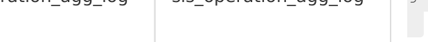

Alibaba Cloud  
Apsara Stack  
Log Service  
Operations and Maintenance  
Guide  
Product Version: V3.18.3  
Document Version: 20241029

**Table of Contents**

- [1.O&M methods](#section-1)
- [2.O&M](#section-2)
    - [2.1. Use the service terminal to view logs on machines](#section-2-1)
    - [2.2. Use the CLI to maintain Log Service](#section-2-2)
    - [2.3. Use CDS-Intelligent O&M to query logs](#section-2-3)

<a id="section-1"></a>

# 1.O&M methods

This topic describes the two O&M methods of Log Service.

Log Service is deployed, managed, and maintained by using the Apsara Infrastructure Management console. Log Service supports the following O&M methods:

- Terminal: In the Apsara Infrastructure Management console, you can use the terminal service to log on to the machine where Log Service resides and view logs.

- Command-line interface (CLI): Log Service provides the CLI to meet the requirements for automated configurations. You can use the CLI to manage projects, Logstores, machine groups, consumer groups, and Logtail configurations. You can also use the CLI to query logs.

**Terminal**

1. Log on to the Apsara Uni-manager Operations Console.

2. Log on to the Apsara Infrastructure Management console. In the top navigation bar of the Apsara Uni-manager Operations Console, click **Products**. Then, choose **Base/Platforms > Apsara Infrastructure Management**.

3. Go to the Project O&M page.

   <ol type="i">

   <li>

   In the left-side navigation pane, click **Project & Cluster O&M**.

   </li>

   <li>

   On the **Project O&M** page, enter  `sls`  in the **Project | Cluster** field.

   </li>

   </ol>

   The  `CdsSlsHybridCluster***`  in the search results is the cluster where Log Service resides.

   <ol type="i" start="3">

   <li>

   Click **Status Details** in the **Actions** column.

   </li>

   </ol>

4. On the **Product Details** page, select a component and click **Terminal** in the Actions column. In this example, the sls-backend-server.ServiceTest component is used.

5. Log on to the machine by using the terminal service and go to the related directory to view logs.

**CLI**

Log Service CLI provides the following features:

- Supports most RESTful API operations of Log Service. For example, you can use the CLI to manage projects, Logstores, machine groups, consumer groups, and Logtail configurations.

- Allows you to manage logs across multiple accounts and regions.

- Allows you to query and pull logs.

- Allows you to migrate data from Elasticsearch to Log Service.

- Supports flexible time configurations.

- Allows you to replicate logs across regions at a high speed, reindex historical logs, and ship logs to data warehouses.

1. Download and install the Log Service CLI. For more information, see Log Service CLI.

2. Obtain a project name, an endpoint, and an AccessKey pair. For more information, see the related topics in **Log Service Developer Guide**.

3. Use Log Service CLI to query logs and maintain Log Service. For more information, see Log Service CLI.

<a id="section-2"></a>

# 2.O&M

<a id="section-2-1"></a>

## 2.1. Use the service terminal to view logs on machines

In the Apsara Infrastructure Management console, you can use the terminal service to log on to the machine where Log Service resides and view logs.

**DBPostHandler#**

- Startup log: /cloud/app/sls-backend-server/DBPostHandler#/db_post_handler/current/log/start.log

- Service log: none

**DBPreHandler#**

- Startup log: /cloud/app/sls-backend-server/DBPreHandler#/db_pre_handler/current/log/start.log

- Service log: none

**InitSlsCluster#**

- Startup log: /cloud/app/sls-backend-server/InitSlsCluster#/init_sls_cluster/current/log/start.log

- Service log: none

**ServiceTest#**

- Startup log: /cloud/app/sls-backend-server/ServiceTest#/service_test_monitor/current/log/service_monitor.log

- Service log: none

**SlsAppProcessMonitor#**

- Startup logs:

  - /cloud/app/sls-backend-server/SlsAppProcessMonitor#/sls_common_worker_monitor/current/log/start.log

  - /cloud/app/sls-backend-server/SlsAppProcessMonitor#/sls_config_service_monitor/current/log/start.log

  - /cloud/app/sls-backend-server/SlsAppProcessMonitor#/sls_etl_framework_monitor/current/log/start.log

  - /cloud/app/sls-backend-server/SlsAppProcessMonitor#/sls_loghub_master_monitor/current/log/start.log

  - /cloud/app/sls-backend-server/SlsAppProcessMonitor#/sls_presto_worker_monitor/current/log/start.log

  - /cloud/app/sls-backend-server/SlsAppProcessMonitor#/sls_query_master_monitor/current/log/start.log

  - /cloud/app/sls-backend-server/SlsAppProcessMonitor#/sls_quota_server_monitor/current/log/start.log

  - /cloud/app/sls-backend-server/SlsAppProcessMonitor#/sls_replay_worker_monitor/current/log/start.log

  - /cloud/app/sls-backend-server/SlsAppProcessMonitor#/sls_shennong_worker_monitor/current/log/start.log

- Service log: none

**SlsCommonWorkerDecider#**

- Startup log: /cloud/app/sls-backend-server/SlsCommonWorkerDecider#/sls_common_worker_decider/current/log/start.log

- Service log: none

**SlsConfigManager#**

- Startup log: /cloud/app/sls-backend-server/SlsConfigManager#/sls_config_manager/current/log/start.log

- Service log: none

**SlsConfigServiceDecider#**

- Startup log: /cloud/app/sls-backend-server/SlsConfigServiceDecider#/sls_config_service_decider/current/log/start.log

- Service log: none

**SlsDeployFuxiless#**

- Startup log: /cloud/app/sls-backend-server/SlsDeployFuxiless#/sls_deploy_fuxiless/current/log/start.log

- Service log: none

**SlsEtlFrameworkDecider#**

- Startup log: /cloud/app/sls-backend-server/SlsEtlFrameworkDecider#/sls_etl_framework_decider/current/log/start.log

- Service log: none

**SlsImportOdpsScheduler#**

- Startup log: /cloud/app/sls-backend-server/SlsImportOdpsScheduler#/sls_import_odps_scheduler/current/log/start.log

- Service log: none

**SlsLoghubMasterDecider#**

- Startup log: /cloud/app/sls-backend-server/SlsLoghubMasterDecider#/sls_loghub_master_decider/current/log/start.log

- Service log: none

**SlsPrometheus#**

- Startup log: /cloud/app/sls-backend-server/SlsPrometheus#/sls_prometheus/current/log/start.log

- Service log: none

**SlsQueryMasterDecider#**

- Startup log: /cloud/app/sls-backend-server/SlsQueryMasterDecider#/sls_query_master_decider/current/log/start.log

- Service log: none

**SlsQuotaServerDecider#**

- Startup log: /cloud/app/sls-backend-server/SlsQuotaServerDecider#/sls_quota_server_decider/current/log/start.log

- Service log: none

**SlsReplayWorkerDecider#**

- Startup log: /cloud/app/sls-backend-server/SlsReplayWorkerDecider#/sls_replay_worker_decider/current/log/start.log

- Service log: none

**SlsReplayWorkerDecider#**

- Startup log: /cloud/app/sls-backend-server/SlsReplayWorkerDecider#/sls_replay_worker_decider/current/log/start.log

- Service log: none

**SlsShennongWorkerDecider#**

- Startup log: /cloud/app/sls-backend-server/SlsShennongWorkerDecider#/sls_shennong_worker_decider/current/log/start.log

- Service log: none

**ToolService#**

- Startup logs:

  - /cloud/app/sls-backend-server/ToolService#/init_diamond/current/log/diamond_publish_content.LOG

  - /cloud/app/sls-backend-server/ToolService#/init_diamond/current/log/start.log

  - /cloud/app/sls-backend-server/ToolService#/init_odps/current/log/start.log

  - /cloud/app/sls-backend-server/ToolService#/init_pop/current/log/start.log

  - /cloud/app/sls-backend-server/ToolService#/jdk_uploader/current/log/start.log

- Service log: none

<a id="section-2-2"></a>

## 2.2. Use the CLI to maintain Log Service

Log Service provides the command-line interface (CLI) to meet the requirements for automated configurations in Log Service. You can use the CLI to manage projects, Logstores, machine groups, consumer groups, and Logtail configurations. You can also use the CLI to query logs.

**CLI**

Log Service CLI provides the following features:

- Supports most RESTful API operations of Log Service. For example, you can use the CLI to manage projects, Logstores, machine groups, consumer groups, and Logtail configurations.

- Allows you to manage logs across multiple accounts and regions.

- Allows you to query and pull logs.

- Allows you to migrate data from Elasticsearch to Log Service.

- Supports flexible time configurations.

- Allows you to replicate logs across regions at a high speed, reindex historical logs, and ship logs to data warehouses.

1. Download and install the Log Service CLI. For more information, see Log Service CLI.

2. Obtain a project name, an endpoint, and an AccessKey pair.

   For more information, see the related topics in **Log Service Developer Guide**.

3. Use Log Service CLI to query logs and maintain Log Service. For more information, see Log Service CLI.

<a id="section-2-3"></a>

## 2.3. Use CDS-Intelligent O&M to query logs

The system centrally stores and indexes logs of key services. You can query logs within a specified time range by service type, project, and storage service.

**Background information**

Logs are not permanently stored. The system automatically clears logs on a regular basis. The log retention period varies based on the cloud service. The log retention period is determined by the amount of logs and the severity of the logs. The maximum log retention period of Alibaba Cloud services does not exceed 30 days.

**Procedure**

1. Log on to the Apsara Uni-manager Operations Console.

2. In the top navigation bar, choose **Products > Storage > CDS - OPS**.

3. In the left-side navigation pane, choose **CDS-Intelligent Maintenance > Log Search**.

4. On the **Log Search** page, configure the Type, Project, Storage, and Select Date parameters and specify a search condition.

   A search condition consists of a search statement and an analytic statement in the  `Search statement|Analytic statement`  format. Example:  `* | SELECT status, count(*) AS PV GROUP BY status` . The search statement and the analytic statement are separated by a vertical bar (|). The search statement uses proprietary syntax of Simple Log Service.

   A search statement can be executed alone. However, an analytic statement must be executed together with a search statement. You can use the log analysis feature to analyze the data in search results. You can also use the feature to analyze all data in a Logstore. For more information, see "Simple Log Service > Query and analysis" in **CDS User Guide**.

   | Statement | Description |
   | --- | --- |
   | Search statement | A search statement specifies one or more search conditions, and then returns the logs that meet the specified conditions. A search statement can be a keyword, a numeric value, a numeric value range, a space character, or an asterisk (\*). If you specify a space or an asterisk (\*) as the search statement, no conditions are specified and all logs are returned. |
   | Analytic statement | An analytic statement is used to aggregate or analyze all log data or the log data that meets the specified search conditions in a Logstore. |

5. Click **Query**.

   The system displays the log data that meets the conditions.

   > **Note**
   >
   > Different types of logs have different formats. The actual log formats prevail.

**Supported logs**

The following table describes the **Simple Log Service** Logstores whose detailed logs you can query. The logs are generated after Simple Log Service initializes each service.

**Logstore**

**config_name**

**log path**

**server role**

```text
 /apsara/sls/sls_Sl
```

sls-backend-

action_trail

None

server.SlsMetaService

```text
sMetaServiceRole/Act
```

#

```text
ionTrailOplog.LOG 
```

```text
 /apsara/sls/sls_Et
```

```text
                      sls-backend-
lFrameworkPartitionR
```

alert-metering

```text
None
```

```text
server.SlsEtlFramewor
```

```text
ole/alert_metering.L
```

k#

```text
OG 
```

```text
 /apsara/tubo/TempR
```

```text
oot/sys/DispatchWork
```

```text
dispatch_worker_log
                       er/*dispatch_worker.
```

```text
LOG 
```

sls-backend-

dispatch_worker_log

server.SlsDispatchWor ker#

```text
 /apsara/sls/sls_Di
```

```text
spatchWorkerPartitio
```

dispatch_worker_log_f

```text
uxiless                nRole/*dispatch_work
```

```text
er.LOG 
```

```text
 /apsara/sls/sls_Et
```

```text
lFrameworkPartitionR
```

etl_framework_log_fuxi

```text
less                   ole/etl_worker.LOG
```


sls-backend-

etl_framework_log

server.SlsEtlFramewor k#

```text
 /apsara/tubo/TempR
```

etl_framework_log

```text
oot/sys/EtlFramework
```

```text
/etl_worker.LOG 
```

/apsara/tubo/TempRoo

etl_golang_worker_log

t/sys/EtlFramework/etl _golang_worker.LOG

/apsara/sls/sls_EtlFram

sls-backend-

etl_golang_worker_log

eworkPartitionRole/etl_

etl_golang_worker_log

server.SlsEtlFramewor

_fuxiless

golang_worker.LOG

k#

```text
 /apsara/sls/sls_Sh
```

```text
ennongReplayWorkerRo
```

oss_shipper_metering_

```text
log_fuxiless           le/oss_shipper_meter
```

```text
ing.LOG 
```

```text
 /apsara/sls/import
```

```text
_odps/scheduler/odps
```

odps_shipper_meterin

```text
g_log                  _shipper_metering.lo
```

```text
g 
```

sls-backend-

etl_metering

server.SlsShennongWo

```text
 /usr/local/export/
```

rker#

```text
export_*_metering.lo
```

export_metering_log

```text
g 
```

```text
 /usr/local/python-
```

python_etl_metering

```text
etl/metering.log 
```

```text
 /apsara/tubo/TempR
```

oss_shipper_metering_

```text
oot/sys/ShennongRepl
```

```text
log
                       ayWorker/oss_shipper
```

```text
_metering.LOG 
```

```text
 /apsara/sls/sls_Sl
```

redis_op_log

```text
sExportServiceRole/r
```

```text
edis_worker.log 
```

```text
 /apsara/sls/sls_Sl
```

```text
                      sls-backend-
sExportServiceRole/e
```

export_service_worker

export_service_log

```text
server.SlsExportServic
```

```text
_log                   xport_service_worker
                                             e#
```

```text
.log 
```

```text
 /apsara/sls/sls_Sl
```

export_service_log

```text
sExportServiceRole/E
```

```text
xportService.LOG 
```

```text
 /apsara/tubo/TempR
```

```text
oot/sys/FcTriggerWor
```

```text
fc_trigger_log
```

```text
None
```

```text
ker/fc_trigger.log
```


fc_trigger_log

```text
 /apsara/sls/sls_Fc
```

```text
TriggerWorkerRole/fc
```

fc_trigger_log_fuxiless

```text
None
```

```text
_trigger.log 
```

<table>
  <tr>
    <td>forwarder-grpc</td>
    <td>forwarder-grpc</td>
    <td><code>/cloud/app/sls-</code><br><code>backend-</code><br><code>server/SlsForwarderP</code><br><code>rometheus#/sls_forwa</code><br><code>rder_prometheus/curr</code><br><code>ent/forwarder-</code><br><code>grpc.json</code></td>
    <td>None</td>
  </tr>
  <tr>
    <td rowspan="2">forwarder-kafka</td>
    <td>forwarder-kafka-error</td>
    <td><code>/apsara/cloud/app/</code><br><code>sls-backend-</code><br><code>server/SlsForwarderK</code><br><code>afka#/sls_forwarder_</code><br><code>kafka/current/sls_fo</code><br><code>rwarder_kafka_releas</code><br><code>e_64/kafka/logs/erro</code><br><code>r.log</code></td>
    <td>None</td>
  </tr>
  <tr>
    <td>forwarder-kafka-access</td>
    <td><code>/apsara/cloud/app/</code><br><code>sls-backend-</code><br><code>server/SlsForwarderK</code><br><code>afka#/sls_forwarder_</code><br><code>kafka/current/sls_fo</code><br><code>rwarder_kafka_releas</code><br><code>e_64/kafka/logs/acce</code><br><code>ss.log</code></td>
    <td>None</td>
  </tr>
  <tr>
    <td>forwarder-syslog</td>
    <td>forwarder-syslog</td>
    <td><code>/apsara/cloud/app/</code><br><code>sls-backend-</code><br><code>server/SlsForwarderS</code><br><code>yslog#/sls_forwarder</code><br><code>_syslog/current/sls_</code><br><code>forwarder_syslog_rel</code><br><code>ease_64/syslog-</code><br><code>forwarder.json</code></td>
    <td>sls-backend-server.SlsForwarderSy slog#</td>
  </tr>
  <tr>
    <td rowspan="2">kms_sql_log</td>
    <td>kms_sql_log</td>
    <td>/apsara/tubo/TempRoo t/sys/SlsKmsWrapperS ervice/kms_sql.LOG</td>
    <td rowspan="2">sls-backend-server.SlsKmsWrapper Service#</td>
  </tr>
  <tr>
    <td colspan="2"></td>
  </tr>
  <tr>
    <td rowspan="2"></td>
    <td colspan="2"></td>
    <td rowspan="2"></td>
  </tr>
  <tr>
    <td>kms_sql_log_fuxiless</td>
    <td>/apsara/sls/sls_KmsWr apperServiceWorker/k ms_sql.LOG</td>
  </tr>
  <tr>
    <td rowspan="2">kms_worker_log</td>
    <td>kms_worker_log_fuxile ss</td>
    <td><code>/apsara/sls/sls_Km</code><br><code>sWrapperServiceWorke</code><br><code>r/sls_kms_wrapper_se</code><br><code>rvice_worker.LOG</code></td>
    <td rowspan="2">sls-backend-server.SlsKmsWrapper Service#</td>
  </tr>
  <tr>
    <td>kms_worker_log</td>
    <td><code>/apsara/tubo/TempR</code><br><code>oot/sys/SlsKmsWrappe</code><br><code>rService/sls_kms_wra</code><br><code>pper_service_worker.</code><br><code>LOG</code></td>
  </tr>
  <tr>
    <td>logtail_alarm</td>
    <td>None</td>
    <td>None</td>
    <td rowspan="3">sls-backend-server.SlsLogtail#</td>
  </tr>
  <tr>
    <td>logtail_status_profile</td>
    <td>None</td>
    <td>None</td>
  </tr>
  <tr>
    <td>logtail_suicide_profile</td>
    <td>None</td>
    <td>None</td>
  </tr>
  <tr>
    <td>metering</td>
    <td>metering</td>
    <td><code>/apsara/sls/meteri</code><br><code>ng.log</code></td>
    <td>sls-backend-server.SlsMeteringServ ice#</td>
  </tr>
  <tr>
    <td>mirror_service</td>
    <td>mirror_service</td>
    <td><code>/apsara/sls/sls_Sl</code><br><code>sMirrorsls-backend-</code><br><code>server.SlsMirrorServ</code><br><code>ice#ServiceRole/mirr</code><br><code>or_service_worker.LO</code><br><code>G</code></td>
    <td>sls-backend-server.SlsMirrorService #</td>
  </tr>
  <tr>
    <td>nginx_error_log</td>
    <td>nginx_error_log</td>
    <td><code>/apsara/sls/nginx/</code><br><code>logs/error.log</code></td>
    <td>sls-backend-server.Nginx#</td>
  </tr>
  <tr>
    <td>offline_scheduler_log</td>
    <td>offline_scheduler_log</td>
    <td><code>/apsara/sls/import</code><br><code>_odps/scheduler/impo</code><br><code>rt_odps*.log</code></td>
    <td></td>
  </tr>
</table>

```text
 /apsara/tubo/TempR
```

pk-query

```text
oot/sys/ShennongWork
```

```text
er/pk_query.LOG 
```

sls-backend-

pk-query

server.SlsShennongWo rker#

```text
 /apsara/sls/sls_Sh
```

```text
ennongWorkerRole/pk_
```

pk-query_fuxiless

```text
query.LOG 
```

```text
 /apsara/presto/pre
```

```text
sto_data/var/log/gc.
```

presto_gc_log

presto_gc_log

```text
log* 
```

```text
 /apsara/presto/pre
```

```text
sto_data/var/log/htt
```

presto_http

presto_http

```text
p-request.log 
```

```text
 /apsara/presto/pre
```

```text
sto_data/var/log/met
```

presto_metering

presto_metering

```text
ering.log 
```

```text
 /apsara/tubo/TempR
```

```text
oot/sys/PrestoWorker
```

presto_monitor

```text
presto_monitor
                       /presto_monitor.LOG
```


sls-backend-server.SlsPrestoWorke

```text
 /apsara/presto/pre
```

r#

```text
sto_data/var/log/ser
```

presto_server

```text
ver.log 
```

presto_server

```text
 /apsara/sls/presto
```

```text
/presto_data/var/log
```

presto_server_fuxiless

```text
/server.log 
```

/apsara/presto/sls_sql_

presto_sql_server

presto_sql_server

server.LOG

/apsara/tubo/TempRoo

presto_worker

t/sys/PrestoWorker/pre sto_worker.LOG

presto_worker

/apsara/sls/sls_Presto

presto_worker_fuxiless

WorkerRole/presto_wo rker.LOG

<table>
  <tr>
    <td>prometheus-backend-log</td>
    <td>prometheus-backend-log</td>
    <td><code>/cloud/app/sls-</code><br><code>backend-</code><br><code>server/SlsPrometheus</code><br><code>#/sls_prometheus/cur</code><br><code>rent/aos_sls_prometh</code><br><code>eus_release_64/sls_p</code><br><code>rometheus.LOG*</code></td>
    <td rowspan="2">sls-backend-server.SlsPrometheus #</td>
  </tr>
  <tr>
    <td>prometheus-log</td>
    <td>prometheus-log</td>
    <td><code>/cloud/app/sls-</code><br><code>backend-</code><br><code>server/SlsPrometheus</code><br><code>#/sls_prometheus/cur</code><br><code>rent/prometheus*.LOG</code></td>
  </tr>
  <tr>
    <td rowspan="2">query_master_log</td>
    <td>query_master_log</td>
    <td><code>/apsara/tubo/TempR</code><br><code>oot/sys/QueryMaster/</code><br><code>query_master.LOG*</code></td>
    <td rowspan="2">sls-backend-server.SlsQueryMaster #</td>
  </tr>
  <tr>
    <td>query_master_log_fuxil ess</td>
    <td><code>/apsara/sls/sls_Qu</code><br><code>eryMasterRole/query_</code><br><code>master.LOG*</code></td>
  </tr>
  <tr>
    <td>replication_status</td>
    <td>replication_status</td>
    <td><code>/apsara/sls/sls_Sl</code><br><code>sMirrorServiceRole/m</code><br><code>irror_service_schedu</code><br><code>le.LOG</code></td>
    <td>sls-backend-server.SlsMirrorService #</td>
  </tr>
  <tr>
    <td>scmc_access_log</td>
    <td>scmc_access_log</td>
    <td><code>/apsara/sls/nginx/</code><br><code>logs/scmc_access.log</code></td>
    <td rowspan="3">sls-backend-server.SlsScmc#</td>
  </tr>
  <tr>
    <td>scmc_err_log</td>
    <td>scmc_err_log</td>
    <td><code>/apsara/sls/nginx/</code><br><code>logs/scmc_err_log</code></td>
  </tr>
  <tr>
    <td>scmc_op_log</td>
    <td>scmc_op_log</td>
    <td><code>/apsara/sls/nginx/</code><br><code>logs/scmc_op_log</code></td>
  </tr>
  <tr>
    <td>shennong_log_profile</td>
    <td>None</td>
    <td>None</td>
    <td>sls-backend-server.SlsShennongWo rker#</td>
  </tr>
</table>


```text
 /apsara/sls_Config
```

```text
ServiceRole/sls_conf
```

sls_configservice_log

```text
ig_service.LOG 
```

sls_configservice_log

```text
 /apsara/sls/sls_Co
```

```text
nfigServiceRole/sls_
```

sls_configservice_log_f

```text
uxiless                config_service.LOG
```


sls-backend-server.SlsConfigServic e#

```text
 /apsara/tubo/TempR
```

```text
oot/sys/*ConfigServi
```

sls_configservice_quer

```text
y_log                  ce/config_service_qu
```

```text
ery.LOG 
```

sls_configservice_quer y_log

```text
 /apsara/sls/sls_Co
```

```text
nfigServiceRole/conf
```

sls_configservice_quer

```text
y_log_fuxiless         ig_service_query.LOG
```


```text
 /apsara/cloud/app/
```

```text
sls-backend-
```

```text
server/SlsConsole#/s
```

```text
ls_console/current/s
```

```text
sls_console_error_log sls_console_error_log  ls_console/logs/erro
```

```text
r.log 
```

sls-backend-server.SlsConsole#

```text
 /cloud/app/sls-
```

```text
backend-
```

```text
server/SlsConsole#/s
```

sls_console_info_log

```text
sls_console_info_log
```

```text
ls_console/current/s
```

```text
ls_console/logs/info
```

```text
.log 
```

```text
 /apsara/tubo/TempR
```

sls_consumergroup_lo

```text
oot/sys/QuotaServer/
```

g

```text
monitor.LOG 
```

sls-backend-

sls_consumergroup_lo

server.SlsQuotaServer

g

```text
 /apsara/sls/sls_Qu
```

#

sls_consumergroup_lo

```text
otaServerRole/monito
```

g_fuxiless

```text
r.LOG 
  /apsara/sls/sls_Sl
```

sls-backend-

sls_etl20_coordinator_l

sls_etl20_coordinator_l

server.SlsEtl20Coordin

```text
sEtl20CoordinatorRol
```

og

og

atorRole#

```text
e/SlsEtl20.LOG* 
```

/apsara/sls/sls_SlsEtl20

sls-backend-

sls_etl20_job_checker_

sls_etl20_job_checker_

JobCheckerRole/SlsEtl2

server.SlsEtl20JobChec

log

log

0.LOG\*

kerRole#

```text
 /apsara/sls/sls_Sl
```

sls-backend-

sls_etl20_sts_proxy_lo

sls_etl20_sts_proxy_lo

```text
sEtl20StsProxyRole/S
```

server.SlsEtl20StsProx

g

g

yRole#

```text
lsEtl20.LOG* 
```

```text
 /apsara/sls/sls_Sl
```

sls-backend-

sls_etl20_worker_grou

sls_etl20_worker_grou

server.SlsEtl20Worker

```text
sEtl20WorkerGroupBRo
```

pb_log

pb_log

GroupBRole#

```text
le/SlsEtl20.LOG* 
```

```text
 /apsara/sls/sls_Sl
```

sls-backend-

```text
sEtl20WorkerRole/Sls
```

sls_etl20_worker_log

sls_etl20_worker_log

server.SlsEtl20Worker Role#

```text
Etl20.LOG* 
```

```text
 /apsara/sls/fcgi_a
```

sls-backend-

sls_fastcgi_log

sls_fastcgi_log

```text
gent/FastcgiAgent*.L
```

server.SlsFastcgi#

```text
OG 
```

```text
 /apsara/tubo/TempR
```

```text
oot/sys/ShennongWork
```

```text
sls_index_status_log
                       er/project_index_siz
```

```text
e.LOG 
```

sls-backend-server.SlsShennongWo

sls_index_status_log

rker#

```text
 /apsara/sls/sls_Sh
```

```text
ennongWorkerRole/pro
```

sls_index_status_log_f

```text
uxiless                ject_index_size.LOG
```


```text
 /apsara/tubo/TempR
```

```text
oot/sys/LoghubMaster
```

sls_loghub_shard_statu

```text
s_log                  /loghub_master_meta.
```

```text
LOG 
```

sls_loghub_shard_statu s_log

```text
 /apsara/sls/sls_Lo
```

sls_loghub_shard_statu

```text
ghubMasterRole/loghu
```

s_log_fuxiless

```text
b_master_meta.LOG 
```

sls-backend-server.SlsLoghubMast

```text
 /apsara/tubo/TempR
```

```text
                      er#
oot/sys/LoghubMaster
```

```text
sls_loghubmaster_log
                       /sls_loghub_master.L
```

```text
OG 
```

sls_loghubmaster_log

```text
 /apsara/sls/sls_Lo
```

sls_loghubmaster_log_

```text
ghubMasterRole/sls_l
```

fuxiless

```text
oghub_master.LOG 
```

```text
 /apsara/sls/sls_Sl
```

```text
sMetaServiceRole/Met
```

sls_meta_service

sls_meta_service

```text
aService.LOG 
```

sls-backend-server.SlsMetaService #

```text
 /apsara/sls/sls_Sl
```

sls_meta_service_oplo

sls_meta_service_oplo

```text
sMetaServiceRole/Met
```

g

g

```text
aServiceOplog.LOG 
```

```text
 /apsara/tubo/TempR
```

```text
oot/sys/SlsMeteringS
```

sls_metering_service_l

```text
ervice/stdout.out 
```

og

sls-backend-

sls_metering_service_l

server.SlsMeteringServ

og

ice#

```text
 /cloud/log/sls-
```

```text
backend-
```

```text
                       server/SlsMeteringSe
sls_metering_service_l
```

```text
og_fuxiless            rvice#/sls_metering_
```

```text
service_app/tianji/s
```

```text
tdout 
```

```text
 /apsara/sls/fcgi_a
```

sls_monitor_log

sls_monitor_log

```text
gent/monitor_*.LOG
```


```text
 /apsara/sls/fcgi_a
```

```text
gent/metering_*.LOG
```

sls_operation_agg_log

sls_operation_agg_log



sls-backend-server.SlsFastcgi#

```text
 /apsara/sls/fcgi_a
```

```text
gent/ols_operation*.
```

sls_operation_log

sls_operation_log

```text
LOG 
  /apsara/sls/web/lo
```

sls_portal_access_log

sls_portal_access_log

```text
gs/access.log 
```

```text
 /apsara/sls/web/lo
```

sls_portal_api_audit

sls_portal_api_audit

```text
gs/apidetail.log 
```

```text
 /apsara/sls/web/lo
```

sls-backend-

sls_portal_http_req

sls_portal_http_req

server.SlsWeb#

```text
gs/httpclient.log 
```

```text
 /apsara/sls/web/lo
```

sls_portal_normal

sls_portal_normal

```text
gs/normal.log 
```

```text
 /apsara/sls/web/lo
```

sls_portal_sys_info

sls_portal_sys_info

```text
gs/sysinfo.log 
```

```text
 /apsara/tubo/TempR
```

sls_quotaserver_log

```text
oot/sys/QuotaServer/
```

```text
quota_server.LOG 
```

sls_quotaserver_log

```text
 /apsara/sls/sls_Qu
```

sls_quotaserver_log_fu

```text
otaServerRole/quota_
```

xiless

```text
server.LOG 
```

sls-backend-server.SlsQuotaServer #

```text
 /apsara/tubo/TempR
```

```text
oot/sys/QuotaServer/
```

sls_quotausage_log

```text
charge.LOG 
```

sls_quotausage_log

```text
 /apsara/sls/sls_Qu
```

sls_quotausage_log_fu

```text
otaServerRole/charge
```

xiless

```text
.LOG 
```

/apsara/tubo/TempRoo t/sys/ShennongReplay

sls_replayworker_log

Worker/shennong_repl ay_worker.LOG

sls-backend-

/apsara/sls/sls_Shenno

sls_replayworker_log

server.SlsReplayWorke

sls_replayworker_log_f

ngReplayWorkerRole/s

r#

uxiless

hennong_replay_worke r.LOG

<table>
  <tr>
    <td>sls_service_error_log</td>
    <td>sls_service_error_log</td>
    <td><code>/alidata/www/logs/</code><br><code>java/sls-</code><br><code>service/applog/error</code><br><code>.log</code></td>
    <td rowspan="2">sls-backend-server.SlsConsoleServi ce#</td>
  </tr>
  <tr>
    <td>sls_service_info_log</td>
    <td>sls_service_info_log</td>
    <td><code>/alidata/www/logs/</code><br><code>java/sls-</code><br><code>service/applog/info.</code><br><code>log</code></td>
  </tr>
  <tr>
    <td rowspan="2">sls_shennongworker_lo g</td>
    <td>sls_shennongworker_lo g</td>
    <td><code>/apsara/tubo/TempR</code><br><code>oot/sys/ShennongWork</code><br><code>er/shennong_worker.L</code><br><code>OG</code></td>
    <td rowspan="5">sls-backend-server.SlsShennongWo rker#</td>
  </tr>
  <tr>
    <td>sls_shennongworker_lo g_fuxiless</td>
    <td><code>/apsara/sls/sls_Sh</code><br><code>ennongWorkerRole/she</code><br><code>nnong_worker.LOG</code></td>
  </tr>
  <tr>
    <td>trace_log</td>
    <td>trace_log</td>
    <td><code>/apsara/shennong_a</code><br><code>gent/tracer/index_wo</code><br><code>rker_trace.LOG</code></td>
  </tr>
  <tr>
    <td rowspan="2">worker_input_log</td>
    <td>worker_input_log</td>
    <td><code>/apsara/tubo/TempR</code><br><code>oot/sys/ShennongWork</code><br><code>er/shennong_worker_i</code><br><code>nput.LOG</code></td>
  </tr>
  <tr>
    <td>worker_input_log_fuxil ess</td>
    <td><code>/apsara/sls/sls_Sh</code><br><code>ennongWorkerRole/she</code><br><code>nnong_worker_input.L</code><br><code>OG</code></td>
  </tr>
</table>
