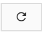

Alibaba Cloud  
Apsara Stack Enterprise  
Tablestore  
User Guide  
Product Version: V3.12.0  
Document Version: 20220928

**Table of Contents**

- [1.What is Tablestore?](#section-1)
- [2.Precautions](#section-2)
- [3.Quick start](#section-3)
    - [3.1. Log on to the Tablestore console](#section-3-1)
    - [3.2. Create instances](#section-3-2)
    - [3.3. Create tables](#section-3-3)
    - [3.4. Read and write data in the console](#section-3-4)
    - [3.5. Bind a VPC to a Tablestore instance](#section-3-5)

# 1.What is Tablestore?

Tablestore is a NoSQL database service independently developed by Alibaba Cloud. Tablestore is a proprietary software program that is certified by the relevant authorities in China. Tablestore is built on the Apsara system of Alibaba Cloud, and can store large amounts of structured data and allow real-time access to these data.

Tablestore provides the following features:

- Offers schema-free data storage. You do not need to define attribute columns before you use them. Table-level changes are not required to add or delete attribute columns. You can configure the time to live (TTL) parameter for a table to manage the lifecycle of data. The expired data is deleted from the table.

- Adopts the triplicate technology to keep three copies of data on three servers across three different racks. A cluster can support single storage type instances (SSD only) or mixed storage type instances (SSD and HDD) to meet different budget and performance requirements.

- Adopts a fully redundant architecture that prevents single points of failure (SPOFs). Tablestore supports smooth online upgrades, hot cluster upgrades, and automatic data migration, which enable you to dynamically add or remove nodes for maintenance without incurring service interruptions. The concurrent read and write throughput and storage capacity can be linearly scaled. Each cluster can have at least 500 hosts.

- Supports highly concurrent read and write operations. Concurrent read and write capabilities can be scaled out as the number of hosts increases. The read and write performance is indirectly related to the amount of data in a single table.

- Supports identity authentication and multi-tenancy. Comprehensive access control and isolation mechanisms are provided to safeguard your data. VPC and access over HTTPS are supported. Provides multiple authentication and authorization mechanisms so that you can define access permissions on individual tables and operations.

# 2.Precautions

Before you use Tablestore, you need to take note of the following precautions and limits.

The following table describes the limits for Tablestore. A part of the limits indicate the maximum allowable values rather than the suggested values. To ensure better performance, set the table scheme and data size in a single row based on actual conditions, and adjust the following configurations.

| Item | Limit | Description |
| --- | --- | --- |
| The number of instances under an Apsara Stack tenant account | 1024 | To raise the limit, contact the technical support personnel. |
| The number of tables in an instance | 1024 | To raise the limit, contact the technical support personnel. |
| The length of an instance name | 3 to 16 bytes | The instance name can contain uppercase and lowercase letters, digits, and hyphens (-). It must start with a letter and cannot end with a hyphen (-). |
| The length of a table name | 1 to 255 bytes | The table name can contain uppercase and lowercase letters, digits, and underscores (_). It must start with a letter or underscore (_). |
| The length of a column name | 1 to 255 bytes | The column name can contain uppercase and lowercase letters, digits, and underscores (_). It must start with a letter or underscore (_). |
| The number of columns in a primary key | 1 to 4 | A primary key can contain one to four primary key columns. |
| The size of the value in a string type primary key column | 1 KB | The size of the value in a STRING primary key column cannot exceed 1 KB. |
| The size of the value in a STRING attribute column | 2 MB | The size of the value in a STRING attribute column cannot exceed 2 MB. |
| The size of the value in a BINARY primary key column | 1 KB | The size of the value in a BINARY primary key column cannot exceed 1 KB. |
| The size of the value in a BINARY attribute column | 2 MB | The size of the value in a BINARY attribute column cannot exceed 2 MB. |
| The number of attribute columns in a single row | Unlimited | A single row can contain an unlimited number of attribute columns. |
| The number of attribute columns written by one request | 1,024 | During a PutRow, UpdateRow, or BatchWriteRow operation, the number of attribute columns written in a row cannot exceed 1,024. |
| The data size of a row | Unlimited | The total size of all column names and column values for a row is unlimited. |

# 3.Quick start

## 3.1. Log on to the Tablestore console

This topic describes how to log on to the Tablestore console.

Prerequisites

- Before logging on to the ASCM console, make sure that you have obtained the IP address or domain name of the ASCM console from the deployment personnel. The URL used to access the ASCM console is in the following format: http://IP address or domain name of the ASCM console/manage.

- We recommend that you use the Google Chrome browser.

Procedure

1. Enter the URL of the Apsara Uni-manager Management Console in the address bar and press the Enter key.

2. Enter your username and password.

   Obtain the username and password that you use to log on to the Apsara Uni-manager Management Console from the operations administrator.

   Note

   The first time that you log on to the Apsara Uni-manager Management Console,

   you must change the password of your account. For security purposes, your password must meet the minimum complexity requirements. The password must be 10 to 32 characters in length and must contain at least two of the following character types:

   - Uppercase or lowercase letters

   - Digits

   - Special characters, including exclamation points (!), at signs (@), number signs (#), dollar signs ($), and percent signs (%)

3. Click Log On.

4. In the top navigation bar, choose Products > TableStore.

## 3.2. Create instances

An instance is a logical entity in Tablestore and is used to manage tables. An instance is the basic unit of the resource management system of Tablestore. Tablestore implements application access control and resource measurement at the instance level. This topic describes how to create an instance.

Procedure

1. Log on to the Tablestore console.

2. On the Overview tab, click Create Instance.

   Note

   You can create different instances to manage the tables for different businesses,

   or create different instances for development, testing, and production environments of the same business. By default, Tablestore allows you to create up to 1,024 instances and up to 1,024 tables in each instance under an Apsara Stack tenant account.

3. On the Create Tablestoree Instance page, configure the following parameters.

   | Parameter | Description |
   | --- | --- |
   | Region | Select a region from the drop-down list for the instance. |
   | Organization | Select an organization from the drop-down list for the instance. |
   | Resource Set | Select a resource set from the drop-down list for the instance. |
   | Instance Name | Enter a name for the instance. Instance naming conventions: The name must be 3 to 16 characters in length and can contain only letters, digits, and hyphens (-). It must start with a letter and cannot start with case insensitive string <code> ali </code> or <code> ots </code>. |
   | Description | Enter a description for the instance. |
   | Instance Type | Select an instance type from the drop-down list for the instance. Tablestore provides high-performance instances and capacity instances. The instance types vary based on the type of cluster you deploy. |

4. Click Submit.

5. In the Submitted. dialog box, click Back to Console.

   On the Overview tab, you can view the created instance.

   After the instance is created, you can perform the following operations on the instance:

   - Click the instance name or click Manage Instance in the Actions column. On the Instance Management page, click each tab to perform various operations.

     - On the Instance Details tab, you can view the Instance Access URL, Basic Information, and Tables sections.

     - On the Instance Monitoring tab, you can view monitoring data by using time ranges, metric categories, and operations.

     - On the Network Management tab, you can bind or unbind VPCs and view the list of VPCs.

   - Click Release in the Actions column to release an instance.

     Notice

     - Before you release an instance, ensure that all tables are deleted, and VPCs are unbound from instances.

     - To create an instance when you release an existing instance, ensure that the name of the instance you want to create is different from that of the existing instance to avoid conflicts.

## 3.3. Create tables

This topic describes how to create a table in the Tablestore console.

Procedure

1. Log on to the Tablestore console.

2. On the Overview page, click the name of the required instance or click Manage Instance in the Actions column corresponding to the instance.

3. On the Instance Details tab, click Create Table.

   Note

   You can create a maximum of 1,024 tables in each instance.

4. In the Create Table dialog box, set Table Name and Primary Key.

   The following table describes the parameters you can configure.

   | Parameter | Description |
   | --- | --- |
   | Table Name | The name of the table. This name is used to uniquely identify a table in an instance. The name must be 1 to 255 bytes in length and can contain letters, digits, and underscores (_). The name must start with a letter or an underscore (_). |
   | Primary Key | One or more primary key columns in the table that uniquely identify each record in the table. Enter a primary key name and select a data type. Click Add a Primary Key to add a primary key column. You can add one to four primary key columns. By default, the first primary key column is the partition key. The configurations and order of primary key columns cannot be modified after the table is created. Note • In Tablestore, only a primary key column can be used as an auto-increment primary key column. Partition keys cannot be used as auto-increment primary key columns. • After a primary key column is set to an auto-increment primary key column, Tablestore automatically generates a value for the auto-increment primary key column when you write a row of data. You do not need to specify a value for the auto-increment primary key column. The values of auto-increment primary key columns are incremental and unique within the rows that share the same partition key. • Naming conventions of primary key columns: The name must be 1 to 255 bytes in length and can contain letters, digits, and underscores (_). The name must start with a letter or underscore (_) • Data types supported by primary key columns are String, Integer, and Binary. |

5. Optional. Configure advanced parameters.

   If you need to configure parameters such as Time to Live and Max Versions, perform this operation.

   <ol type="i">

   <li>

   Turn on Advanced Settings.

   </li>

   <li>

   Configure advanced parameters.

   </li>

   </ol>

   The following table describes the advanced parameters you can configure.

   <table>
     <tr>
       <th>Parameter</th>
       <th>Description</th>
     </tr>
     <tr>
       <td>Time to Live</td>
       <td>The period for which data in the table can be retained. When the retention period exceeds the Time to Live (TTL) value, the system deletes the expired data. The minimum TTL value is 86,400 seconds (one day). A value of -1 indicates that data never expires.</td>
     </tr>
     <tr>
       <td>Max Versions</td>
       <td>The maximum number of versions of data that can be retained for an attribute column. When the versions of data in an attribute column exceed the Max Versions value, the system deletes the earliest versions of data to keep the maximum number of versions equal to the Max Versions value. Valid values: 1 to 10.</td>
     </tr>
     <tr>
       <td>Max Version Offset</td>
       <td>The difference between the version number and the data written time must be within the value of Max Version Offset. Otherwise, an error occurs when the data is written. Unit: seconds. The valid version range for attribute columns is calculated based on the following formula: Valid version range = [Data written time – Max version offset value, Data written time + Max version offset value).</td>
     </tr>
     <tr>
       <td>Reserved Read Throughput</td>
       <td rowspan="2">You can set this parameter only for high-performance instances. The read and write throughput that is allocated and reserved for the table. Valid values: integers from 0 to 5000. When the specified reserved read and write throughput is 0, Tablestore does not reserve related resources for the table.</td>
     </tr>
     <tr>
       <td>Reserved Write Throughput</td>
     </tr>
   </table>

6. Optional. Create secondary indexes.

   If you need to create secondary indexes, perform this operation.

   <ol type="i">

   <li>

   Turn on Create Secondary Index.

   </li>

   <li>

   Click the + Add button in the Pre-defined Column section. Enter the name of the pre-defined

   </li>

   </ol>

   column and select a data type from the drop-down list.

   - This operation is performed to create a predefined column for the base table. Tablestore uses a schema-free model. You can write an unlimited number of columns to a row and do not need to specify a fixed number of predefined columns in a schema. When you create a table, you can also predefine columns and specify their data types.

   - You can add up to 14 predefined columns. To deleted the predefined column you add, click

     the  icon on the left of the corresponding predefined column.

   - The name of a predefined column must be 1 to 255 bytes in length and can contain letters, digits, and underscores (_). The name must start with a letter or underscore (_).

   - The data types of predefined columns include STRING, INTEGER, BINARY, FLOAT, and BOOLEAN.

   <ol type="i" start="3">

   <li>

   Click Add Secondary Index. Enter Index Name and set Primary Key and Pre-defined Column

   </li>

   </ol>

   for the index table.

   - The name of an index table must be 1 to 255 bytes in length and can contain letters, digits, and underscores (_). The name must start with a letter or underscore (_).

   - You can set the primary key of the index table to the primary key or predefined columns of the base table.

   - Pre-defined Column is optional. You can set the predefined columns of the index table to only the predefined columns of the base table.

7. Click OK.

   After a table is created, you can view the table in the Table List section. If the created table is not

   displayed in the list of tables, click the  icon to refresh the list of tables.

   After a table is created, you can perform the following operations on the table:

   - Click the name of the table or click Details in the Actions column. On the Manage Table page, you can perform the following operations:

     - On the Details tab, you can view the description of the table and the primary key columns list, and modify the attributes of the table.

     - On the Data Editor tab, you can insert or update data, query data, view data details, and delete multiple data at a time.

       

   - Click the

     icon in the Actions column corresponding to a table and choose Delete from the

     shortcut menu. Click OK in the Delete Table dialog box. The table is deleted.

     Notice

     If you delete a table, the table and the data in the table are permanently

     deleted from Tablestore and cannot be recovered. Exercise caution when you perform this operation.

## 3.4. Read and write data in the console

After a table is created, you can read data from and write data to the table in the console.

Add data

1. Log on to the Tablestore console.

2. On the Overview page, click the name of the required instance or click Manage Instance in the Actions column corresponding to the instance.

3. In the Table List section of the Instance Details tab, click the name of the target table and click the Data Editor tab. You can also click Data Editor in the Actions column.

4. On the Data Editor tab, click Insert.

5. In the Insert dialog box that appears, set Primary Key Value. Click Add Column. Set Name, Type, Value, and Version.

   By default, System Time is selected, indicating that the current system time is used as the version number of the data. You can also clear System Time and enter the version number of the data.

6. Click OK.

   Rows that contain the written data are displayed on the Data Editor tab.

Update data

You can update data in the attribute columns of a row.

1. Log on to the Tablestore console.

2. On the Overview page, click the name of the required instance or click Manage Instance in the Actions column corresponding to the instance.

3. In the Table List section of the Instance Details tab, click the name of the target table and click the Data Editor tab. You can also click Data Editor in the Actions column.

4. On the Data Editor tab, select the row of data to update. Click Update.

5. In the Update dialog box that appears, modify the type and value for the primary key, add or remove attribute columns, and update or delete data in attribute columns.

   - You can click +Add Column to add an attribute column. You can also click the  icon to delete

     an attribute column.

   - If you select Update, you can modify data in attribute columns. If you select Delete, select the number of version to delete. If you select Delete All, all versions of the data are deleted.

6. Click OK.

Query data

In the Tablestore console, you can query data in a single row (GetRow) or query data within a specified range (RangeQuery).

To query data in a single row, perform the following operations:

1. Log on to the Tablestore console.

2. On the Overview page, click the name of the required instance or click Manage Instance in the Actions column corresponding to the instance.

3. In the Table List section of the Instance Details tab, click the name of the target table and click the Data Editor tab. You can also click Data Editor in the Actions column.

4. On the Data Editor tab, click Search.

5. Set filter conditions.

   <ol type="i">

   <li>

   In the Search dialog box, Set Modes to GetRow.

   </li>

   <li>

   By default, the system returns all columns. To return specified attribute columns, turn off All

   </li>

   </ol>

   Columns. Enter the names of the attribute columns to return. Separate the names of the attribute columns with commas (,).

   <ol type="i" start="3">

   <li>

   Set Primary Key Value.

   </li>

   </ol>

   The integrity and accuracy of the primary key value affect the query results.

   <ol type="i" start="4">

   <li>

   Set Count of Versions to specify the maximum number of versions to return.

   </li>

   </ol>

6. Click OK.

   Data that meets the filter conditions is displayed on the Data Editor tab.

To perform range query, perform the following steps:

1. Log on to the Tablestore console.

2. On the Overview page, click the name of the required instance or click Manage Instance in the Actions column corresponding to the instance.

3. In the Table List section of the Instance Details tab, click the name of the target table and click the Data Editor tab. You can also click Data Editor in the Actions column.

4. On the Data Editor tab, click Search.

5. Set filter conditions.

   <ol type="i">

   <li>

   In the Search dialog box, Set Modes to Range Search.

   </li>

   <li>

   By default, the system returns all columns. To return specified attribute columns, turn off All

   </li>

   </ol>

   Columns. Enter the names of the attribute columns to return. Separate the names of the attribute columns with commas (,).

   <ol type="i" start="3">

   <li>

   Set Start Primary Key Column and End Primary Key Column.

   </li>

   </ol>

   You can set Start Primary Key Column to Min Value or Custom and End Primary Key Column to Max Value or Custom. If you select Custom, enter a custom value.

   Note

   - The value in the first primary key column takes priority when the range query mode is used. When the minimum and maximum values for the first primary key column are the same, the system uses the value in the second primary key column to perform the query. The query rules for the subsequent primary keys are the same as those for the first two primary keys.

   - The Custom range is a left-open and right-closed interval.

   <ol type="i" start="4">

   <li>

   Set Count of Versions to specify the maximum number of versions to return.

   </li>

   <li>

   Set Sequence to Forward Search or Backward Search.

   </li>

   </ol>

6. Click OK.

   Data that meets the filter conditions is displayed based on the specified order on the Data Editor tab.

Delete data

You can delete data you no longer need.

1. Log on to the Tablestore console.

2. On the Overview page, click the name of the required instance or click Manage Instance in the Actions column corresponding to the instance.

3. In the Table List section of the Instance Details tab, click the name of the target table and click the Data Editor tab. You can also click Data Editor in the Actions column.

4. On the Data Editor tab, select the row of data you want to delete. Click Delete.

5. In the Delete message that appears, click OK.

## 3.5. Bind a VPC to a Tablestore instance

After you bind a VPC to a Tablestore instance, you can access the Tablestore instance from the ECS instances in the VPC in the same region.

Prerequisites

- A VPC that is within the same region as the Tablestore instance is created.

- After the VPC is created, create an ECS instance in the VPC.

Procedure

1. Log on to the Tablestore console.

2. On the Overview page, click the name of the required instance or click Manage Instance in the Actions column corresponding to the instance.

3. Click the Network Management tab.

4. On the Network Management tab, click Bind VPC.

5. In the Bind VPC dialog box, select a VPC and switch, enter Instance VPC Name.

   The name of a VPC can contain only letters and digits and must start with a letter. The name must be 3 to 16 bytes in length.

6. Click OK.

   After the VPC is bound to the instance, you can view the information of the VPC in the VPC List on the Network Management tab. You can use the VPC address to access the Tablestore instance from the ECS instances in the VPC.

   After you bind a VPC, you can perform the following operations:

   - Click VPC Instance List in the Actions column to view the VPC instances list, which contains the instance name, instance VPC name, and VPC domain name.

   - Click Unbind in the Actions column to unbind the VPC from the instance. After the VPC is unbound, the ECS instance in the VPC can no longer access the Tablestore instance by using the VPC address. To access the Tablestore instance from the ECS instance, you must bind the VPC to the Tablestore instance again.
